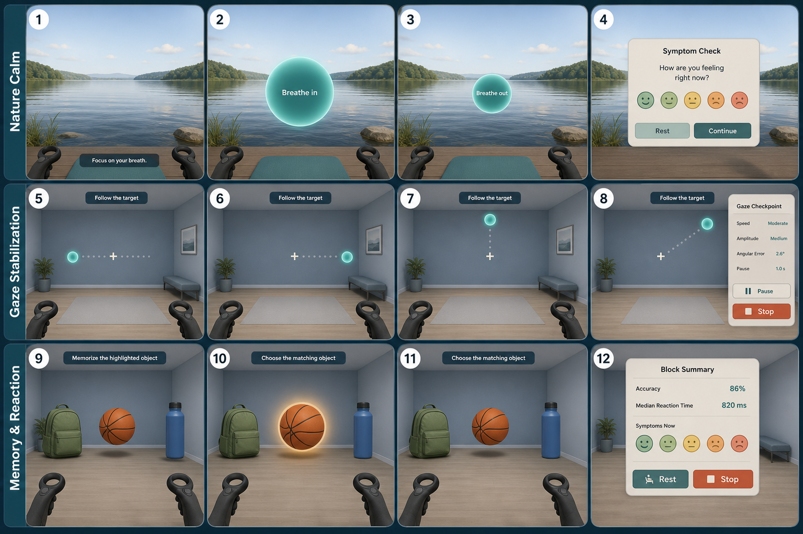

# Concussion VR intervention storyboard v1

Status: design specification for clinician review, not a treatment protocol.

## Reference-image review

The storyboard synthesizes interface patterns observed in:

- VR stress-management research: a fixed nature viewpoint, restrained interaction, and guided breathing inside a stable scene. Source: https://doi.org/10.3389/fpsyg.2021.640341
- Multisensory nature-immersion research: a stable lake or beach scene and a single breathing sphere. Source: https://doi.org/10.3389/frvir.2023.1261093
- VR vestibular rehabilitation: clinician-adjustable direction, speed, amplitude, duration, pause, and stop controls. Source: https://www.kinequantum.com/vestibulaire-vr
- A 2025 vestibular rehabilitation trial: fixed-target, pursuit, and VOR-style head movement with progressive visual complexity. Source: https://doi.org/10.3389/fneur.2025.1519470
- Reh@City cognitive rehabilitation: recognizable objects, one instruction at a time, and ecologically meaningful memory tasks. Source: https://doi.org/10.1186/s12984-020-00691-5

Commercial imagery was used only to identify interaction patterns. No scene, artwork, layout, or branded interface is copied.

## Design rules

- Seated mode and stationary camera are the default.
- A stable horizon or fixation anchor remains visible.
- Peripheral movement, flicker, particles, lens flare, and automatic camera motion are excluded.
- Only one instruction and one stimulus goal appear at a time.
- Teal is the active target color; muted orange is reserved for caution and stopping.
- Every active block ends with a symptom checkpoint.
- Difficulty is clinician-authored. The software does not prescribe treatment.
- Quest 3 output is recorded as head-gaze, not eye gaze.

## Storyboard

| Frame | Module | Participant view | Runtime event | Recorded data | Exit |
|---|---|---|---|---|---|
| 1 | Nature Calm | Quiet lake, fixed horizon, no overlay | Block begins | start time, pose baseline | breathing cue |
| 2 | Nature Calm | Teal sphere expands | inhale phase | phase timing, head rotation | next phase |
| 3 | Nature Calm | Teal sphere contracts | exhale phase | adherence duration | checkpoint |
| 4 | Checkpoint | Symptom rating, Rest/Continue | participant response | symptoms, rest choice | clinician gate |
| 5 | Gaze | Center anchor and slow horizontal target | left-to-right pursuit | target/head angle | reverse |
| 6 | Gaze | Slow return sweep | right-to-left pursuit | angular error, reacquisition | vertical |
| 7 | Gaze | Vertical target path | vertical pursuit | directional error | checkpoint |
| 8 | Checkpoint | Speed, amplitude, error, Pause/Stop | clinician decision | prescribed dose, stop reason | next block |
| 9 | Memory | Three familiar objects, one cue | encode target | target identity, display time | conceal cue |
| 10 | Memory | Objects shown at equal size | response window opens | response time | selection |
| 11 | Memory | Selected object receives feedback | response resolves | accuracy, latency | summary |
| 12 | Summary | Accuracy, median latency, symptoms | block closes | summary and adverse event | rest/stop |

## Unity development specification

### Nature Calm

Parameters:

- horizon height
- global luminance preset
- breathing cycle duration
- sphere minimum and maximum scale
- permitted background motion
- block duration
- audio enabled and audio level

Acceptance criteria:

- The camera never translates or rotates automatically.
- The horizon remains fixed during the entire block.
- The breathing cue uses the bundled unlit shader and never renders magenta.
- No environmental object crosses the central 20-degree visual field.
- Escape and observer stop remain available.

### Gaze stabilization

Parameters:

- direction: horizontal, vertical, diagonal
- target angular velocity
- target amplitude in degrees
- target size in degrees
- background complexity
- trial duration
- rest duration

Acceptance criteria:

- Target movement starts and stops with eased velocity.
- Horizontal and vertical trials are stored separately.
- Target position and head orientation share timestamps.
- Angular error, time off target, and reacquisition time are exported.
- The module is labeled head-gaze on Quest 3.

### Memory and reaction

Parameters:

- object set
- object count
- cue duration
- retention interval
- response window
- trial count
- distractor enabled

Acceptance criteria:

- Objects are recognizable without reading.
- Color is not the only identifier.
- Object position is counterbalanced.
- Accuracy, omissions, incorrect responses, median latency, and latency variability are stored.
- Feedback is brief and does not flash.

## Deliberately excluded from v1

- free walking
- moving camera or artificial locomotion
- optokinetic stripes
- crowded supermarket scenes
- automatic difficulty progression
- performance-based rewards
- diagnostic or recovery-clearance language
- unsupervised adolescent use

## Required review before implementation freeze

1. Concussion clinician confirms eligibility, exposure, stopping, and recovery rules.
2. Vestibular therapist reviews pursuit speed, amplitude, and direction ranges.
3. Research team chooses the validated symptom instrument and checkpoint schedule.
4. Healthy-adult usability testing verifies readability, input, and cybersickness.
5. IRB materials distinguish research tasks from clinical care.

