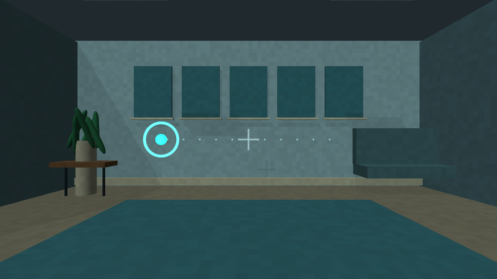
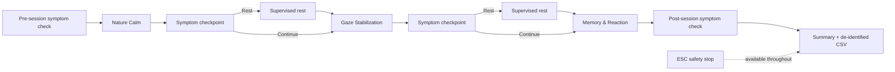
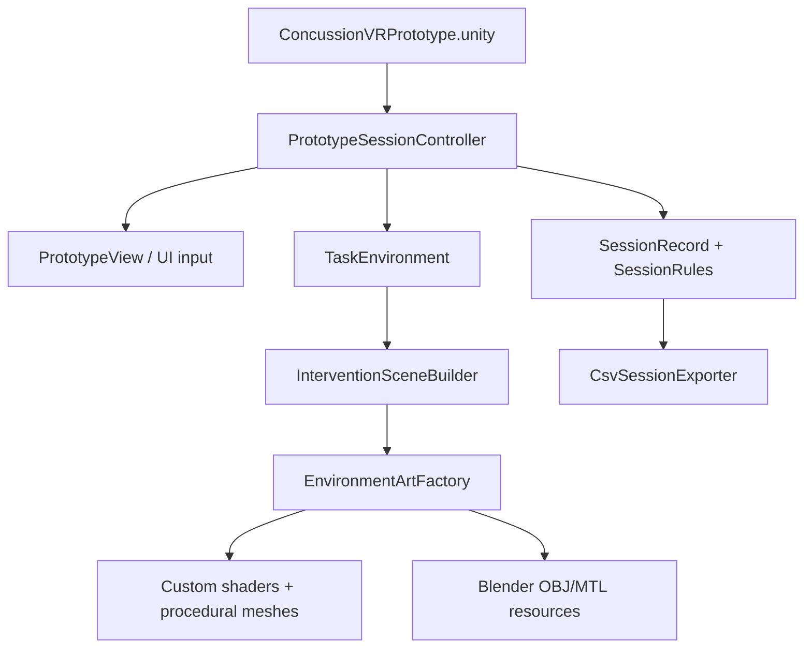

# Concussion VR Prototype

뇌진탕 이후 증상을 가진 청소년을 대상으로, 감독하에 실시하는 저자극·증상 제한형 VR 재활 연구를 준비하기 위한 Unity 프로토타입입니다.

> **Research prototype only.** 이 소프트웨어는 의료기기나 독립적인 치료 도구가 아니며, 뇌진탕 진단·회복 판정·운동 복귀 결정을 제공하지 않습니다. 실제 청소년 대상 사용은 승인된 연구계획, IRB, 보호자 동의/참가자 동의, 그리고 자격을 갖춘 임상가의 감독이 선행되어야 합니다.

## 프로젝트 목표

이 프로젝트가 검토하려는 핵심 질문은 다음과 같습니다.

- 뇌진탕 후 매일 실시하는 증상 맞춤형 VR 노출이 일일 증상 점수의 감소 속도와 관련되는가?
- 정서·신체/시각·인지 영역별 과제를 수행한 뒤 해당 영역의 증상이 상대적으로 더 빠르게 개선되는가?
- 증상 변화와 함께 head-gaze 추적 오차, 기억 정확도, 반응시간 같은 수행 지표를 안전하게 수집할 수 있는가?

현재 저장소는 이 질문을 바로 검증하는 완성된 임상시험 시스템이 아니라, 연구 흐름과 세 가지 인터벤션을 구현하고 시험하기 위한 **개발·타당성 프로토타입**입니다.

## 현재 화면

<table>
  <tr>
    <th>Nature Calm</th>
    <th>Gaze Stabilization</th>
    <th>Memory &amp; Reaction</th>
  </tr>
  <tr>
    <td></td>
    <td></td>
    <td></td>
  </tr>
  <tr>
    <td>고정된 수평선, 저진폭 물결, 호흡 가이드</td>
    <td>수평·수직 이동 표적과 고정 기준점</td>
    <td>백팩·농구공·물병 기억 및 선택</td>
  </tr>
</table>

위 이미지는 Unity Editor에서 동일한 런타임 장면을 카메라로 렌더링한 QA 캡처입니다. Quest 3 헤드셋 실기기 캡처는 아닙니다.

### 전체 스토리보드


상세 설계 근거와 프레임별 데이터 계약은 [인터벤션 스토리보드](Docs/INTERVENTION_STORYBOARD.md)를 참고하십시오.

## 제안된 Single-Case Experimental Design

세 명의 참가자를 위한 연구 설계의 우선 후보는 참가자 간 **staggered multiple-baseline SCED**입니다. 자연 회복이 빠르게 진행되는 뇌진탕 특성상 단순한 전후 비교만으로는 중재 효과와 시간 경과 효과를 분리하기 어렵기 때문입니다.

| 구성 | 제안 내용 | 현재 구현 상태 |
|---|---|---|
| 참가자 | 뇌진탕 진단 후 연구 적격성을 충족한 고등학생 3명 | 미구현 — 연구 프로토콜 필요 |
| Phase A | 참가자별 길이가 다른 baseline 관찰, 일일 증상 측정 | 미구현 |
| Phase B | 감독하의 일일 VR 세션과 증상 체크포인트 | 세션 프로토타입 구현 |
| 1차 결과 | 승인된 검증 증상척도의 일일 총점 및 변화율 | 6항목 자리표시자 구현 |
| 2차 결과 | 영역별 증상, head-gaze 오차, 기억 정확도, 반응시간 | 일부 구현 |
| 분석 | level, trend, immediacy, overlap, phase별 slope 및 민감도 분석 | 미구현 |

최종 baseline 길이, 세션 빈도, 중단 기준, 임상적으로 허용되는 증상 증가량과 분석계획은 임상가·방법론자·IRB 검토 후 확정해야 합니다. 회복 과정에서 치료를 철회하는 reversal/ABAB 설계는 우선안으로 두지 않습니다.

## 세션 흐름



기본 프로토타입 파라미터는 Nature Calm 12초, Gaze Stabilization 15초, Memory & Reaction 6 trials입니다. 이 값은 임상 용량이 아니라 빠른 개발 검증을 위한 설정입니다.

## 인터벤션 설계

### 1. Nature Calm — emotional regulation

- 앉은 자세와 고정 카메라를 기본으로 사용합니다.
- 고정 수평선, 청록색–파란색 하늘, 부드러운 아침광과 선형 안개를 사용합니다.
- 중앙의 단일 호흡 구체가 들숨과 날숨을 안내합니다.
- 물 셰이더의 파고는 `0.006`으로 제한해 움직임을 낮게 유지합니다.
- 자동 카메라 이동, 입자, 깜박임, 렌즈 플레어와 강한 주변부 운동은 사용하지 않습니다.
- Blender에서 생성한 저폴리 파인 트리와 Unity 절차형 호수·산 메시를 사용합니다.

현재 기록: 과제 지속시간과 과제 후 증상 점수.

### 2. Gaze Stabilization — physical/visual task

- 임상실 형태의 안정적인 배경과 중앙 고정 기준점을 제공합니다.
- 청록색 표적이 먼저 수평, 이후 수직 방향으로 천천히 이동합니다.
- 카메라 전방 벡터와 표적 방향 사이의 각도를 표본화하여 평균 오차를 계산합니다.
- Quest 3 기본형에는 안구추적 센서가 없으므로 현재 지표는 **eye gaze가 아닌 head-gaze proxy**입니다.
- 현재 프로토타입은 걷기를 포함하지 않으며 사용자는 카메라/머리를 가능한 안정적으로 유지합니다.

향후 걷기 또는 트레드밀 결합은 별도의 낙상 위험 평가, 감독 프로토콜, 하네스/환경 설계와 임상 승인을 거친 뒤 독립 모듈로 개발합니다.

현재 기록: 평균 head-gaze 각도 오차와 표본 수.

### 3. Memory & Reaction — cognitive task

- 글자를 읽지 않아도 구분 가능한 백팩, 농구공, 물병을 사용합니다.
- 목표 물체를 1.2초 동안 확대해 제시한 뒤 크기를 원래대로 되돌립니다.
- 참가자는 `1`, `2`, `3` 중 하나를 선택합니다.
- 짧고 비점멸 방식의 피드백을 제공합니다.
- Blender 원본과 Unity용 OBJ/MTL을 함께 관리합니다.

현재 기록: 정답 수, trial 수, 정답 반응시간의 중앙값.

## 증상 및 데이터 모델

현재 UI는 각 항목을 정수로 기록합니다.

- headache
- dizziness
- nausea
- eye strain
- light sensitivity
- concentration difficulty

이 여섯 항목은 UI와 데이터 파이프라인을 검증하기 위한 **자리표시자**입니다. 실제 연구에서는 사용 허가와 연구대상 연령에 적합한 검증 척도 및 정식 채점 규칙으로 교체해야 합니다.

세션 종료 또는 안전 중단 시 다음 변수가 한 행의 CSV로 저장됩니다.

| 영역 | 변수 예시 |
|---|---|
| 식별·시간 | `participant_id`, `session_id`, `started_utc`, `ended_utc` |
| 완료 상태 | `status`, `stop_reason` |
| 증상 | `pre_total`, `after_calm_total`, `after_pursuit_total`, `post_total`, `max_symptom_increase` |
| Nature Calm | `calm_seconds` |
| Gaze | `pursuit_mean_error_degrees`, `pursuit_samples` |
| Cognition | `memory_correct`, `memory_trials`, `median_correct_reaction_seconds` |

저장 위치:

```text
Application.persistentDataPath/ConcussionVR/Sessions
```

현재 CSV는 개인식별정보를 수집하도록 설계하지 않았지만, 연구 배포 전 participant ID 생성·접근권한·암호화·보존·폐기 규칙을 별도로 확정해야 합니다.

## 안전 설계 원칙

- 감독하의 seated mode를 기본값으로 사용합니다.
- 안정적인 수평선 또는 fixation anchor를 유지합니다.
- 한 화면에는 하나의 지시와 하나의 주된 자극 목표만 둡니다.
- 각 능동 과제 뒤 증상 체크포인트와 휴식 선택지를 제공합니다.
- `Esc` 키로 언제든 세션을 중단하고 중단 사유를 저장할 수 있습니다.
- 난이도는 소프트웨어가 임상적으로 처방하거나 자동 증가시키지 않습니다.
- 진단, 회복 판정, 운동 복귀를 암시하는 문구를 사용하지 않습니다.
- 청소년의 무감독 사용은 v1 범위에서 제외합니다.

## 기술 구조



### 주요 폴더

```text
Assets/ConcussionVR/
├── Editor/       # 장면 생성 및 QA 캡처 도구
├── Resources/    # Blender 모델과 커스텀 셰이더
├── Runtime/      # 세션 흐름, 환경, UI, 데이터 내보내기
├── Scenes/       # 실행 장면
└── Tests/        # EditMode 및 PlayMode 테스트
ArtSource/Blender/ # 편집 가능한 Blender 원본
Docs/              # 스토리보드, 화면 및 QA 자료
Tools/Blender/     # 절차형 Blender 자산 생성 스크립트
```

## 실행 방법

### 요구 사항

- Unity `6000.4.9f1`
- Windows 개발 환경
- Blender 5.x — 자산을 재생성할 때만 필요
- Meta Quest 연동은 아직 개발 예정이며 현재 버전은 Unity Editor/데스크톱 입력 중심입니다.

### Unity Editor

1. Unity Hub에서 저장소 폴더를 엽니다.
2. `Assets/ConcussionVR/Scenes/ConcussionVRPrototype.unity`를 엽니다.
3. Play를 누릅니다.
4. 증상 화면은 마우스로 조작합니다.
5. 기억 과제에서는 `1`, `2`, `3` 키를 사용합니다.
6. 언제든 `Esc`를 누르면 안전 중단 흐름으로 이동합니다.

### Blender 자산 재생성

```powershell
blender --background --python Tools/Blender/build_intervention_assets.py
```

스크립트는 Blender 원본, Unity용 OBJ/MTL과 QA preview를 다시 생성합니다. Blender가 PATH에 없다면 실행 파일의 전체 경로를 사용하십시오.

### QA 화면 캡처

Unity 메뉴에서 다음을 실행합니다.

```text
Concussion VR > Capture High Fidelity Previews
```

캡처는 `Docs/QA/HighFidelity/`에 저장됩니다.

## 테스트

Unity Test Runner에서 EditMode와 PlayMode 테스트를 실행합니다.

현재 자동 검증 범위:

- 세션 시작 화면과 버튼 전환
- 증상 증가 허용 규칙
- Nature Calm 호수·산 메시, 파인 트리, sky/water shader
- 수평·수직 pursuit target 이동
- Blender 기반 기억 과제 오브젝트와 재질
- 기억 cue 표시 및 해제

최근 검증 결과: PlayMode `2/2` 통과 및 Windows standalone build 성공.

## 개발 로드맵

| 단계 | 개발 목표 | 완료 기준 | 상태 |
|---|---|---|---|
| P0 | 데스크톱 연구 흐름, 안전 중단, CSV | 전체 세션을 중단/완료하고 데이터 저장 | 완료 |
| P1 | 세 인터벤션의 시각 프로토타입 | storyboard contract와 QA 화면 통과 | 완료 |
| P2 | 임상가 설정용 dose profile | 시간·속도·진폭·trial·휴식을 세션 전에 고정 | 예정 |
| P3 | OpenXR 및 Quest 3 controller/head pose | 실기기에서 입력·프레임률·고정 수평선 검증 | 예정 |
| P4 | 고해상도 시계열 기록 | 표적과 head pose를 같은 timestamp로 저장 | 예정 |
| P5 | SCED study layer | phase 일정, daily measure, 결측 및 protocol deviation 기록 | 예정 |
| P6 | 데이터 보호 | ID 정책, 암호화, export 검증, 감사 로그 | 예정 |
| P7 | 건강한 성인 usability pilot | 입력 오류·가독성·cybersickness·중단 흐름 검증 | 예정 |
| P8 | 임상/IRB 승인 후 제한적 feasibility | 사전 정의된 안전·수용성 기준 충족 | 예정 |

### 다음 구현 우선순위

1. `ScriptableObject` 기반 clinician-authored difficulty profile
2. Gaze 모듈의 표적 위치와 head pose 동시 시계열 기록
3. Quest 3 OpenXR 입력 및 성능 예산 검증
4. 검증된 증상척도와 연구용 participant/session 관리
5. 참가자별 staggered baseline과 일일 측정 스케줄
6. 분석용 long-format CSV/JSON export 및 데이터 dictionary

## v1에서 의도적으로 제외한 기능

- 자유 보행과 artificial locomotion
- 자동 카메라 이동
- optokinetic stripe 및 복잡한 군중 장면
- 자동 난이도 상승
- 점수 경쟁과 강한 보상 효과
- eye-tracking을 지원하지 않는 기기의 측정치를 eye gaze로 표기하는 행위
- 진단 또는 recovery clearance 기능

## 검토가 필요한 연구 결정

1. 임상 적격성, 중단 기준, 허용 가능한 증상 증가량
2. 검증 증상척도와 측정 빈도
3. 참가자별 baseline 길이와 phase 전환 규칙
4. pursuit 속도·진폭·방향 범위
5. 걷기 과제의 필요성 및 낙상 방지 프로토콜
6. 데이터 보안, 보존기간과 접근권한
7. 사전등록 분석계획 및 시각분석자 간 신뢰도 절차

## 라이선스와 사용

현재 별도의 오픈소스 라이선스는 지정되어 있지 않습니다. 따라서 저장소 내용의 재사용·배포 권한이 자동으로 부여되지 않습니다. 연구 또는 협업 배포 전에 코드·모델·참고자료의 라이선스를 확정하십시오.