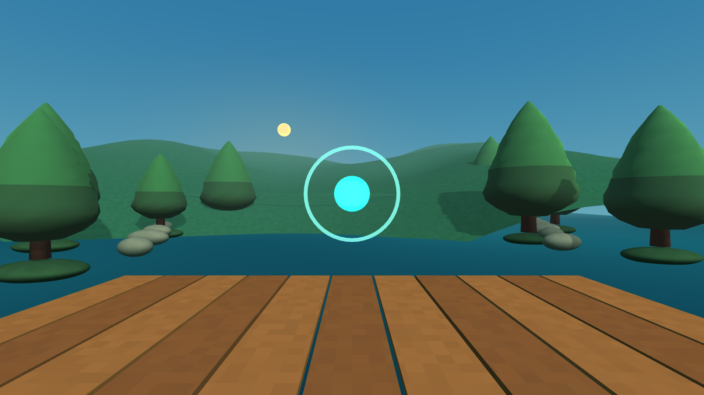
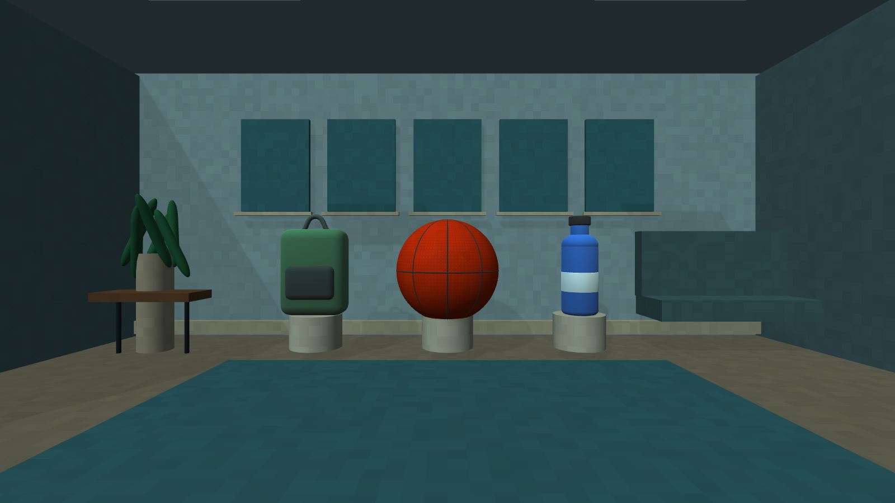
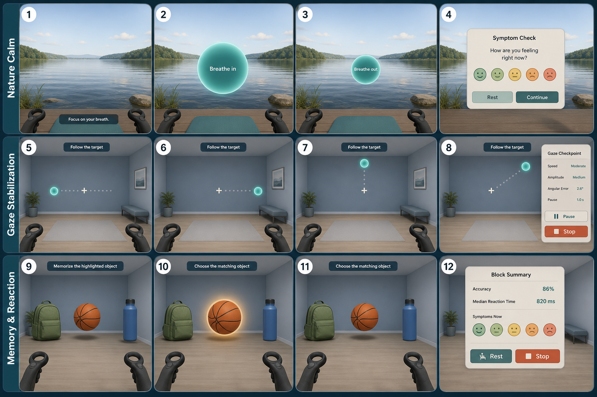
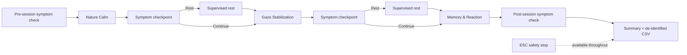
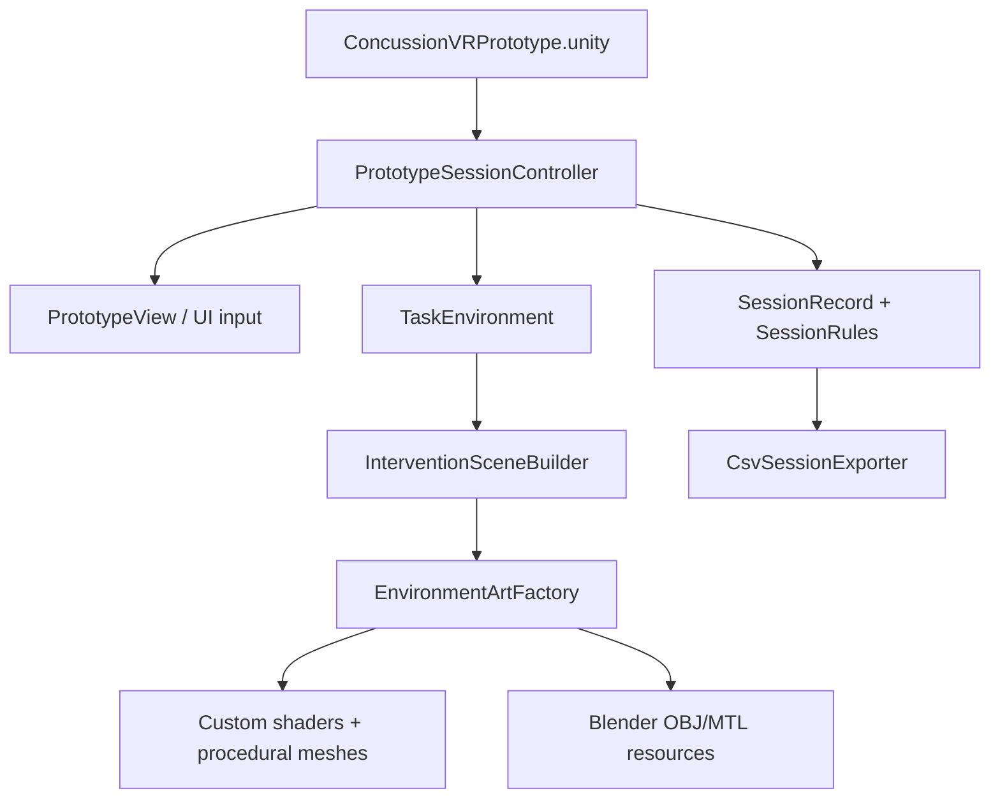

# Concussion VR Prototype

A Unity prototype for preparing a low-stimulus, symptom-limited VR rehabilitation study for adolescents with persistent symptoms after concussion.

> **Research prototype only.** This software is not a medical device or an independent treatment tool. It does not diagnose concussion, determine recovery, or provide return-to-play clearance. Any use with adolescents requires an approved research protocol, IRB approval, parental permission and participant assent, and supervision by qualified clinicians.

## Project Goals

The project is designed to support investigation of the following questions:

- Is daily, symptom-targeted VR exposure after concussion associated with a faster reduction in daily symptom scores?
- Do symptoms associated with emotional, physical/visual, and cognitive domains improve more quickly after repeated exposure to the corresponding task?
- Can symptom change be recorded safely alongside performance measures such as head-gaze tracking error, memory accuracy, and reaction time?

This repository is not a completed clinical trial platform. It is a **development and feasibility prototype** for implementing and testing the research flow and three intervention modules.

## Current Screens

<table>
  <tr>
    <th>Nature Calm</th>
    <th>Gaze Stabilization</th>
    <th>Memory &amp; Reaction</th>
  </tr>
  <tr>
    <td></td>
    <td></td>
    <td></td>
  </tr>
  <tr>
    <td>Fixed horizon, low-amplitude water, and breathing guide</td>
    <td>Horizontal and vertical target paths with a fixation anchor</td>
    <td>Backpack, basketball, and bottle memory choices</td>
  </tr>
</table>

These images are QA captures rendered by a Unity Editor camera from the same runtime environments. They are not captures from a Quest 3 headset.

### Full Storyboard



See the [intervention storyboard](Docs/INTERVENTION_STORYBOARD.md) for the detailed design rationale and frame-by-frame data contract.

## Proposed Single-Case Experimental Design

A **staggered multiple-baseline SCED across participants** is the preferred candidate design for three participants. Because concussion symptoms can change rapidly through natural recovery, a simple pre/post comparison would make it difficult to separate an intervention effect from the passage of time.

| Component | Proposed approach | Current implementation |
|---|---|---|
| Participants | Three high-school students with concussion who meet the approved eligibility criteria | Not implemented; requires a research protocol |
| Phase A | Participant-specific staggered baseline periods with daily symptom measurement | Not implemented |
| Phase B | Supervised daily VR sessions with symptom checkpoints | Session prototype implemented |
| Primary outcome | Daily total score and rate of change from an approved validated symptom scale | Six-item placeholder implemented |
| Secondary outcomes | Domain-specific symptoms, head-gaze error, memory accuracy, and reaction time | Partially implemented |
| Analysis | Level, trend, immediacy, overlap, phase-specific slopes, and sensitivity analyses | Not implemented |

Final baseline lengths, session frequency, stopping rules, clinically allowable symptom increase, and the statistical analysis plan must be approved by clinicians, methodologists, and the IRB. A reversal or ABAB design that withdraws treatment during recovery is not the preferred option.

## Session Flow



The default prototype settings are 12 seconds for Nature Calm, 15 seconds for Gaze Stabilization, and six Memory & Reaction trials. These values support rapid development testing and do not represent a clinical dose.

## Intervention Design

### 1. Nature Calm — Emotional Regulation

- Uses a seated posture and a stationary camera by default.
- Presents a fixed horizon, a teal-to-blue sky, soft morning light, and linear fog.
- Uses one central breathing sphere to guide inhalation and exhalation.
- Limits the water shader wave amplitude to `0.006` to reduce visual motion.
- Excludes automatic camera motion, particles, flicker, lens flare, and strong peripheral movement.
- Uses Blender-generated low-poly pine trees with procedural Unity lake and mountain meshes.

Currently recorded: task duration and post-task symptom ratings.

### 2. Gaze Stabilization — Physical/Visual Task

- Uses a stable clinic-like background and a central fixation anchor.
- Moves a teal target slowly in horizontal and then vertical directions.
- Samples the angle between the camera forward vector and the target direction to calculate mean error.
- Because the standard Quest 3 does not provide an eye-tracking sensor, the current measure is a **head-gaze proxy, not eye gaze**.
- The current prototype does not include walking; the user is instructed to keep the camera/head as stable as possible.

A future walking or treadmill condition must be developed as a separate module after fall-risk assessment, supervision procedures, harness/environment planning, and clinical approval.

Currently recorded: mean head-gaze angular error and sample count.

### 3. Memory & Reaction — Cognitive Task

- Uses a backpack, basketball, and bottle that can be recognized without reading.
- Enlarges the target object for 1.2 seconds before returning all choices to their baseline scale.
- Accepts participant responses using `1`, `2`, or `3`.
- Provides brief, non-flashing feedback.
- Maintains both editable Blender source and Unity-ready OBJ/MTL assets.

Currently recorded: correct responses, number of trials, and median reaction time for correct responses.

## Symptom and Data Model

The current UI records an integer rating for each of the following items:

- Headache
- Dizziness
- Nausea
- Eye strain
- Light sensitivity
- Difficulty concentrating

These six items are **placeholders** for validating the UI and data pipeline. Before use in a study, they must be replaced with an age-appropriate validated instrument, the required usage permissions, and its official scoring rules.

When a session is completed or stopped for safety, the following variables are exported as one row of CSV data:

| Domain | Example variables |
|---|---|
| Identity and time | `participant_id`, `session_id`, `started_utc`, `ended_utc` |
| Completion status | `status`, `stop_reason` |
| Symptoms | `pre_total`, `after_calm_total`, `after_pursuit_total`, `post_total`, `max_symptom_increase` |
| Nature Calm | `calm_seconds` |
| Gaze | `pursuit_mean_error_degrees`, `pursuit_samples` |
| Cognition | `memory_correct`, `memory_trials`, `median_correct_reaction_seconds` |

Storage location:

```text
Application.persistentDataPath/ConcussionVR/Sessions
```

The current CSV pipeline is not intended to collect directly identifying information. Before research deployment, the team must define participant ID generation, access control, encryption, retention, and secure deletion procedures.

## Safety Design Principles

- Supervised seated mode is the default.
- A stable horizon or fixation anchor remains visible.
- Each screen presents one instruction and one primary stimulus goal.
- Each active module is followed by a symptom checkpoint and a rest option.
- The `Esc` key can stop the session at any time and records the stop reason.
- The software does not prescribe or automatically increase clinical difficulty.
- The interface does not use diagnostic, recovery, or return-to-play language.
- Unsupervised adolescent use is excluded from the v1 scope.

## Technical Architecture



### Main Directories

```text
Assets/ConcussionVR/
├── Editor/        # Scene generation and QA capture tools
├── Resources/     # Blender models and custom shaders
├── Runtime/       # Session flow, environments, UI, and data export
├── Scenes/        # Executable Unity scene
└── Tests/         # EditMode and PlayMode tests
ArtSource/Blender/ # Editable Blender source
Docs/              # Storyboards, screenshots, and QA evidence
Tools/Blender/     # Procedural Blender asset-generation script
```

## Running the Prototype

### Requirements

- Unity `6000.4.9f1`
- Windows development environment
- Blender 5.x, only when regenerating assets
- Meta Quest integration is planned; the current version is centered on Unity Editor and desktop input.

### Unity Editor

1. Open the repository folder in Unity Hub.
2. Open `Assets/ConcussionVR/Scenes/ConcussionVRPrototype.unity`.
3. Enter Play Mode.
4. Use the mouse on symptom-assessment screens.
5. Use `1`, `2`, or `3` during the memory task.
6. Press `Esc` at any time to enter the safety-stop flow.

### Regenerating Blender Assets

```powershell
blender --background --python Tools/Blender/build_intervention_assets.py
```

The script regenerates the Blender source, Unity-ready OBJ/MTL assets, and a QA preview. If Blender is not available on `PATH`, use the full path to the executable.

### Capturing QA Screens

Run the following Unity menu command:

```text
Concussion VR > Capture High Fidelity Previews
```

Captures are saved in `Docs/QA/HighFidelity/`.

## Testing

Run the EditMode and PlayMode suites with Unity Test Runner.

Current automated coverage includes:

- Session startup screen and button transitions
- Symptom-increase progression rules
- Nature Calm lake and mountain meshes, pine trees, and sky/water shaders
- Horizontal and vertical pursuit-target motion
- Blender-based memory-task objects and materials
- Memory-cue presentation and removal

Latest verified result: PlayMode `2/2` passed and the Windows standalone build completed successfully.

## Development Roadmap

| Phase | Development goal | Completion criterion | Status |
|---|---|---|---|
| P0 | Desktop research flow, safety stop, and CSV export | Complete or stop a full session and save data | Complete |
| P1 | Visual prototypes for all three interventions | Pass the storyboard contract and QA screen review | Complete |
| P2 | Clinician-authored dose profiles | Lock duration, speed, amplitude, trials, and rest settings before a session | Planned |
| P3 | OpenXR and Quest 3 controller/head pose | Validate input, frame rate, and fixed horizon on the device | Planned |
| P4 | High-resolution time-series logging | Store target and head pose with shared timestamps | Planned |
| P5 | SCED study layer | Record phase schedules, daily measures, missingness, and protocol deviations | Planned |
| P6 | Data protection | Validate ID policy, encryption, export, and audit logging | Planned |
| P7 | Healthy-adult usability pilot | Validate input errors, readability, cybersickness, and safety-stop flow | Planned |
| P8 | Limited feasibility study after clinical and IRB approval | Meet predefined safety and acceptability criteria | Planned |

### Next Implementation Priorities

1. `ScriptableObject`-based clinician-authored difficulty profiles
2. Synchronized target-position and head-pose time-series recording for the Gaze module
3. Quest 3 OpenXR input and performance-budget validation
4. A validated symptom instrument with study participant/session management
5. Participant-specific staggered baselines and daily measurement schedules
6. Long-format CSV/JSON export and a data dictionary for analysis

## Features Intentionally Excluded from v1

- Free walking and artificial locomotion
- Automatic camera motion
- Optokinetic stripes and visually crowded scenes
- Automatic difficulty progression
- Competitive scoring and intense reward effects
- Labeling measurements as eye gaze on hardware without eye tracking
- Diagnostic or recovery-clearance functions

## Research Decisions Requiring Review

1. Clinical eligibility, stopping criteria, and allowable symptom increase
2. Validated symptom instrument and measurement frequency
3. Participant-specific baseline lengths and phase-transition rules
4. Pursuit speed, amplitude, and direction ranges
5. Whether a walking task is necessary and the associated fall-prevention protocol
6. Data security, retention period, and access controls
7. Preregistered analysis plan and inter-rater reliability procedures for visual analysis

## License and Use

No open-source license is currently specified. Therefore, the repository does not automatically grant permission to reuse or distribute its contents. The licenses for the code, models, and reference materials must be finalized before research or collaborative distribution.